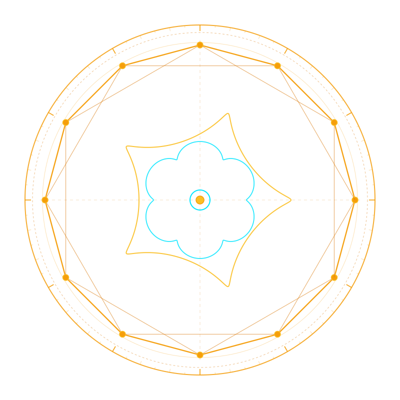

# ⚡ Talos (`talos-dist`) — Official Distribution & Verification Hub

> **Headless Zero-Inbound Outpost Sentinel & Yamux-Multiplexed Remote Tunnel Bridge**  
> *Zero cloud dependencies • Pure safe Rust • Musl static standalone binary • 100% Adversarial TDD Tested*

[](https://github.com/rmediatech/talos-dist/releases/tag/v0.2.0)
[](https://rmediatech.com/downloads)
[-blue.svg)](#)
[](#)
[-blueviolet.svg)](SOVEREIGN_RELEASE_KEY.asc)
[](https://rmediatech.com)
[](LICENSE)

<p align="center">
  
</p>

---

## 🏛️ Overview

**Talos** is an enterprise-grade, zero-cloud outpost sentinel and Yamux-multiplexed remote tunnel bridge written in safe Rust. Named after the mythical bronze automaton that guarded the shores of Crete, Talos enforces an absolute zero-inbound port boundary: it dials outward over encrypted TLS 1.3 / WebSocket channels from behind any NAT, CGNAT, or firewall.

### Core Capabilities
* **Zero Inbound Router Ports**: Operates behind strict NAT and firewalls with zero open listening ports, maintaining outbound-only TLS 1.3 / WebSocket multiplexed sessions.
* **Persistent Headless PTY Terminal**: Headless tmux-style ring buffer guarantees interactive shell commands survive mobile disconnects and network hops without termination.
* **Yamux Virtual Stream Flow-Control**: Features per-stream 256 KiB flow-control windows with backpressure management, preventing stream starvation or memory exhaustion.
* **De-Obfuscating 4-Tier Command Safety Gate**: Evaluates AST segments across chained shell operators (`;`, `|`, `&`, `\n`), scrubbing ANSI escapes and evasion wrappers to protect outposts from accidental destruction.
* **Punycode & Traversal-Hardened Routing**: Enforces strict RFC 1035 label validation, neutralizing Punycode `xn--` homographs and path-traversal injection attempts.
* **Single Standalone Static Binary**: Statically linked against Musl libc, self-contained, with $<15\text{MB}$ memory footprint.

---

## 📦 Binary Verification & Download

Verified standalone binaries are distributed directly through the **[RMediaTech Sovereign Binary Vault](https://rmediatech.com/downloads)**:

| Platform | Architecture | Checksum (SHA-256) | Vault Download |
| :--- | :--- | :--- | :--- |
| **Linux (Static Musl)** | `x86_64` | `dcd9b3fb4cdb3fa35a7e8cd0fd9eb2a39cad89759172bad6307424e7a5275133` | [Download (2.0 MB)](https://rmediatech.com/bin/talos) |

### 1-Click Stream Download & Installation
```bash
# 1-Click Stream Install
curl -sSL https://rmediatech.com/install/talos | sh

# Or Direct Binary Download
curl -sSL https://rmediatech.com/bin/talos -o talos
chmod +x talos
```

### Cryptographic Provenance Verification (`SOVEREIGN-SIGN-01`)
All releases are cryptographically sealed by `Rick Walker (Sovereign Release Signing Key) <rick@rmediatech.com>` (Key ID: `4E428019A109578B`):

```bash
# Import Public Key
curl -sSL https://rmediatech.com/SOVEREIGN_RELEASE_KEY.asc | gpg --import

# Verify Detached OpenPGP Signature
curl -sSL https://rmediatech.com/signatures/talos -o talos.asc
gpg --verify talos.asc talos
```

---

## 🚀 Quickstart

```bash
# Start zero-inbound outpost sentinel daemon
talos outpost start

# Connect to persistent headless PTY shell
talos session attach

# Check active tunnel bridge status
talos status --json
```

---

## 🛡️ License & Provenance

Dual-licensed under MIT OR Apache-2.0. Cryptographically sealed by Rick Walker (`4E428019A109578B`).
